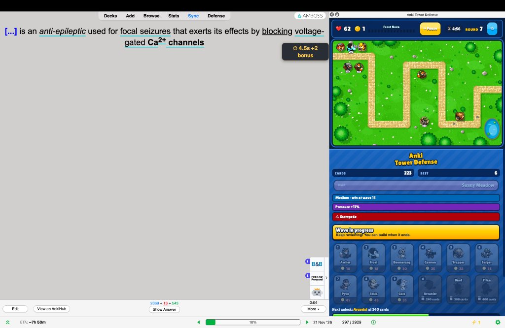

# Anki Tower Defense 🏰⚡

An engaging, fast-paced Tower Defense minigame integrated seamlessly into Anki flashcard reviews. Turn your spaced repetition recall and study streaks into defenses against waves of mischievous slimes!



---

## Key Features

- **Study-Driven Economy & Powers**:
  - Earn study coins by reviewing flashcards. Fast recall grants speed bonus points!
  - Review streaks charge your elemental powers: **Frost Nova** (freezes all active enemies), **Meteor** (shreds slime armor and layers), **Lightning Storm** (strikes random targets across the board), and **Frenzy** (boosts tower attack rate).
- **Draggable Card Reviewer Stopwatch**:
- **12 Unique Towers with Dual Upgrade Paths**:
  - **Archer**: Fast single-target arrows (Path A: Heavy Arrow/Crossbow/Sniper training; Path B: Quick Shot/Triple Shot/Volley).
  - **Frost**: Slows down marching slimes with chilling snow.
  - **Boomer**: Fires explosive area-of-effect cannonballs.
  - **Cannon**: High-damage armor-piercing artillery.
  - **Trapper**: Lays caltrops and spike fields along the path.
  - **Sniper**: Infinite-range targeting prioritizing the strongest or furthest enemies.
  - **Pyro**: Flamethrower dealing stacking burning damage over time.
  - **Tesla**: Chains crackling lightning bolts across packs of slimes.
  - **Gust**: Whirlwinds that shove creeping slimes backwards.
  - **Arcanist**: Cosmic magic that shreds magical shields and armor.
  - **Bard**: Support tower that buffs attack speed and range of nearby allies.
  - **Titan**: Ultimate endgame supertower firing relentless energy barrages.
- **Diverse Slimes & Bosses**:
  - Encounter Basic, Swift (Dasher), Armored (Iron), Magic Shielded (Bulwark), Regenerating (Mender), Splitting (Brood), Phase-shifting (Ghost), and colossal Bosses (Colossus, Behemoth, Prism).
- **Run Modifiers & Difficulties**:
  - Choose between Easy, Medium, Hard, and Extra Hard difficulties.
  - Every run rolls a random Twist (e.g. *Hasty Slimes*, *Iron Tide*, *Supply Shortage*, *Giant Season*).
- **Multiple Maps**:
  - Battle across distinct landscapes: Meadow Crossing, Twin Canyon, Spire Peak, and more with unique choke points and path intersections.
- **Split-Screen or Windowed**:
  - Seamlessly dock next to your card reviews in Anki or toggle into a standalone floating window.

---

## Installation

### Method 1: Install from `.ankiaddon` File (Recommended)
1. Download `anki_tower_defense.ankiaddon` from this repository.
2. In Anki, navigate to **Tools** → **Add-ons**.
3. Click **Install from file...** in the bottom right.
4. Select `anki_tower_defense.ankiaddon`.
5. Restart Anki.

### Method 2: Manual Directory Installation
1. Locate your Anki addons directory:
   - **macOS**: `~/Library/Application Support/Anki2/addons21/`
   - **Windows**: `%APPDATA%\Anki2\addons21\`
   - **Linux**: `~/.local/share/Anki2/addons21/`
2. Clone or copy the `study_defense` directory into `addons21/anki_tower_defense`.
3. Restart Anki.

---

## Standalone Web Preview

Want to play or test the game engine directly in your browser without launching Anki?
Simply double-click or open [preview.html](preview.html) in any modern browser (Chrome, Safari, Firefox, Edge).

To rebuild the standalone preview from the source files:
```bash
python3 -c "import sys; sys.path.insert(0, 'study_defense'); import page; html = page.build_standalone(); open('preview.html', 'w', encoding='utf-8').write(html); print('Rebuilt preview.html')"
```

---

## Controls & Hotkeys

| Key / Action | Function |
|---|---|
| `Space` / `Enter` | Start wave / Proceed to next wave |
| `P` | Pause / Resume wave |
| `1` – `9`, `0`, `-`, `=` | Select tower to place |
| `Esc` | Deselect tower / Close dialogs |
| `Click + Drag` on card stopwatch | Reposition reviewer recall timer |
| `Double Click` on card stopwatch | Reset timer position to default (top-right) |

---

## Testing & Development

The repository includes a complete headless simulation and validation harness in `tools/sim/`:

```bash
# Run all simulation unit tests
for f in tools/sim/*.js; do
  [ "$f" != "tools/sim/harness.js" ] && [ "$f" != "tools/sim/bot.js" ] && node tools/sim/harness.js "$f"
done
```

### Packaging the Add-on
To compile and package the `.ankiaddon` file:
```bash
cd study_defense
zip -FSr ../anki_tower_defense.ankiaddon . -x "__pycache__/*" -x "*/__pycache__/*" -x "*.DS_Store*"
cd ..
```

---

## License

MIT License. Feel free to use, modify, and share!
