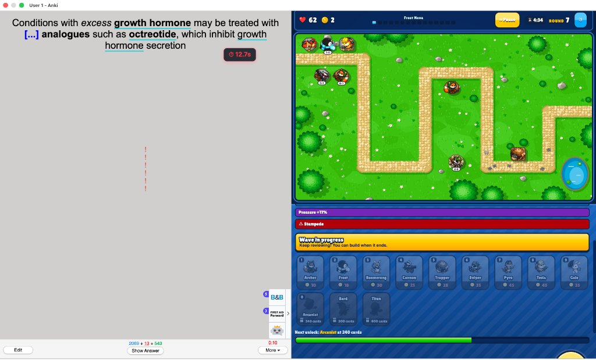

# Anki Tower Defense 🏰⚡

An engaging, fast-paced Tower Defense minigame integrated seamlessly into Anki flashcard reviews. Turn your spaced repetition recall and study streaks into defenses against waves of mischievous slimes!


---

## 📖 Written Description

### What is Anki Tower Defense?
**Anki Tower Defense (AnkiTD)** transforms daily spaced-repetition study sessions into a tactical roguelite tower defense adventure. Instead of grinding through flashcard reviews in isolation, every card you review directly powers your defense grid on the right half of your screen. 

The game was designed around a fundamental active recall principle: **meaningful gamification without cognitive distraction**. While you focus 100% on answering your cards, the game tracks your recall speed, rewards your streaks, and lets you unleash elemental board-clearing spells simply by doing what you came to do: study.

### The Core Feedback Loop
1. **Study to Earn**: Every flashcard answered earns you study coins. Recalling an answer quickly grants extra speed bonus coins.
2. **Build & Upgrade**: Between waves, spend your hard-earned study coins to deploy towers, specialize them across branching upgrade paths, and fortify path choke points.
3. **Survive the Waves**: Waves run alongside your reviews on a 5-minute timer. As you review cards during an active wave, your focus meter charges up and automatically casts devastating study powers: **Frost Nova**, **Meteor**, **Lightning Storm**, and **Frenzy**.
4. **Adaptive Pacing**: Need to pause the game to read a dense card or extra explanation? Hit **Pause** (`P`). The moment you answer the card, the game **automatically unpauses**, keeping your review flow completely uninterrupted.
5. **Unlock & Master**: Progress through lifetime card milestones to unlock higher-tier towers (Arcanist, Bard, Titan) and new maps (Frozen Lake, Twin Canyon, Misty Hollow). Defeat wave bosses, earn map trophies, and test your mettle in Endless Mode!

---

## 🎓 Step-by-Step Tutorial & Gameplay Guide

### Step 1: Launching & Interface Setup
1. Open Anki and click **Defense** in the top navigation bar (or press `Tools` → `Anki Tower Defense`).
2. By default, Anki Tower Defense docks as a **split-screen panel** directly to the right of your flashcards. You can drag the vertical divider to adjust the split width.
3. If you prefer a detached floating window, click the dock toggle button (⧉) in the top-right corner.

### Step 2: The Study Economy & Reviewer Stopwatch
- **The Draggable Stopwatch**: When reviewing cards, a clean timer badge appears on your card showing your recall elapsed time.
  - **Repositioning**: Click and drag the timer badge anywhere on your card so it never obscures card text. Double-clicking it resets it to the top-right corner.
  - **Color-Coded Recall Alert**: The timer turns **vivid red at 5.0 seconds** to keep your recall swift, and turns **grey at 10.0 seconds** once the speed bonus expires.
  - **Speed Bonuses**: Answering quickly flips the timer gold and awards bonus coins (e.g. flips under 2s or 4s grant up to +3 bonus coins per card).
- **Starting Coins**: Every time you launch Anki, your coin balance starts at **25 coins**—enough to place your first 1–2 starter towers immediately.



### Step 3: Placing Your First Defenses
Before launching Wave 1, you are in the **Build Phase**:
1. Look at the slime path on the board. Slimes enter from the entrance and follow the winding dirt track toward your base.
2. Check your coins in the top bar. You start with 25 coins.
3. Select the **Archer** (10 coins) or **Frost** (18 coins) from the bottom-right tower shop.
4. Click on any valid grass tile along the path to construct the tower.
   - *Tip*: Corners and intersections are ideal choke points because towers get multiple opportunities to fire as enemies loop around the bend.
5. If you change your mind before placing, press `Esc` to cancel placement.

### Step 4: Starting Waves & The Auto-Unpause Feature
1. To start the wave, click the large green **Start Wave** button, press `Space`, or simply answer your first card in Anki.
2. Waves run on a steady **5-minute countdown clock**.
3. **Pausing**:
   - If a complex card appears that requires extra reading, click **⏸ Pause** in the top bar or press `P`. The battlefield freezes instantly.
   - **Seamless Unpause**: You don't even need to hit resume! Pressing any answer button (`Again`, `Hard`, `Good`, `Easy`) automatically unpauses the wave.

### Step 5: Unleashing Elemental Study Powers
During an active wave, an elemental **Focus Meter** appears in the top bar. Reviewing cards charges this meter:
- **15 Cards — Frost Nova ❄️**: Instantly flash-freezes every single slime currently on the map for several seconds, giving your towers free hits.
- **30 Cards — Meteor ☄️**: Calls down a massive meteor blast that strips armor and destroys dense slime clusters.
- **45 Cards — Lightning Storm ⚡**: Rains down consecutive lightning strikes across random targets.
- **60 Cards — Frenzy ⚔️**: Hyper-charges all towers on the board, temporarily doubling their attack speed!
*(After 60 cards, the sequence loops back with even more firepower!)*

### Step 6: Upgrades & Tower Synergy
Click any placed tower during the build phase to inspect its stats and choose between **two distinct upgrade paths**:
- **Archer**:
  - *Path A (Heavy Crossbow)*: Increases single-shot damage and armor penetration.
  - *Path B (Volley)*: Drastically increases attack speed and fires multi-arrow spreads.
- **Frost**: Upgrade for wider blizzard auras and permafrost slows.
- **Boomer & Cannon**: Great for clumped groups and explosive splash damage.
- **Trapper**: Drops road spikes to catch fast leaking slimes.
- **Arcanist & Titan**: Late-game towers that deal cosmic/energy damage to bypass iron shields.
- **Bard**: Place in the center of your tower cluster to grant an attack speed and range aura to all neighboring towers.

### Step 7: Overcoming Slime Types & Bosses
- **Green / Yellow / Blue Slimes**: Standard basic health enemies.
- **Dashers (Orange)**: Move with sudden bursts of speed. Slow them with Frost or catch them with Trapper spikes!
- **Iron Slimes (Gray)**: Immune to physical arrows and sharp traps. Counter them with **Arcanist** energy bolts, **Pyro** fire, or **Tesla** electricity!
- **Bulwarks (Shielded)**: Carry shields that absorb a set number of hits before taking hull damage.
- **Menders (Pink)**: Radiate healing pulses to nearby wounded slimes. Focus them down quickly!
- **Colossus & Behemoth**: Massive multi-layered boss slimes that split into smaller slimes when defeated.

### Step 8: Victory, Trophies & Endless Mode
- **Easy Mode**: Survive and clear Wave 12 to win.
- **Medium / Hard / Extra Hard**: Clear Wave 15 to win.
- When you win a run:
  - You earn double end-of-run bonus coins.
  - A permanent gold **Trophy** is recorded for that map.
  - You are given the option to continue into **Endless Mode** to test the absolute limits of your defense grid!

---

## 🌟 Key Features

- **Study-Driven Economy & Powers**:
  - Earn study coins by reviewing flashcards. Fast recall grants speed bonus points!
  - Review streaks charge your elemental powers: **Frost Nova**, **Meteor**, **Lightning Storm**, and **Frenzy**.
- **Draggable Card Reviewer Stopwatch**:
  - A clean, non-intrusive recall timer embedded directly on your Anki review cards.
  - Drag and place it anywhere on your card so it never obscures card text. Double-click resets it to top-right. Position is remembered across sessions.
  - Turns **vivid red at 5 seconds** with an alert glow and fades **grey at 10 seconds** when the speed bonus expires.
- **Wave Pacing & Auto-Unpause**:
  - Pause waves at any time using the top bar button, sidebar button, or `P` key.
  - Answering a review card **automatically unpauses the wave**, keeping your study session flowing without manual toggling.
  - Waves run on an intuitive 5-minute countdown clock.
- **12 Unique Towers with Dual Upgrade Paths**:
  - **Archer**: Fast single-target arrows.
  - **Frost**: Slows down marching slimes with chilling snow.
  - **Boomer**: Fires explosive area-of-effect cannonballs.
  - **Cannon**: High-damage armor-piercing artillery.
  - **Trapper**: Lays caltrops and spike fields along the path.
  - **Sniper**: Infinite-range targeting prioritizing the strongest or furthest enemies.
  - **Pyro**: Flamethrower dealing stacking burning damage over time.
  - **Tesla**: Chains crackling lightning bolts across packs of slimes.
  - **Gust**: Whirlwinds that shove creeping slimes backwards.
  - **Arcanist**: Cosmic magic that shreds magical shields and armor.
  - **Bard**: Support tower that buffs attack speed and range of nearby allies.
  - **Titan**: Ultimate endgame supertower firing relentless energy barrages.
- **Diverse Slimes & Bosses**:
  - Encounter Basic, Swift (Dasher), Armored (Iron), Magic Shielded (Bulwark), Regenerating (Mender), Splitting (Brood), Phase-shifting (Ghost), and colossal Bosses (Colossus, Behemoth, Prism).
- **Run Modifiers & Difficulties**:
  - Choose between Easy, Medium, Hard, and Extra Hard difficulties.
  - Every run rolls a random Twist (e.g. *Hasty Slimes*, *Iron Tide*, *Supply Shortage*, *Giant Season*).
- **Multiple Maps**:
  - Battle across distinct landscapes: Meadow Crossing, Twin Canyon, Spire Peak, and more with unique choke points and path intersections.
- **Split-Screen or Windowed**:
  - Seamlessly dock next to your card reviews in Anki or toggle into a standalone floating window.

---

## 📦 Installation

### Method 1: Install from `.ankiaddon` File (Recommended)
1. Download `anki_tower_defense.ankiaddon` from this repository.
2. In Anki, navigate to **Tools** → **Add-ons**.
3. Click **Install from file...** in the bottom right.
4. Select `anki_tower_defense.ankiaddon`.
5. Restart Anki.

### Method 2: Manual Directory Installation
1. Locate your Anki addons directory:
   - **macOS**: `~/Library/Application Support/Anki2/addons21/`
   - **Windows**: `%APPDATA%\Anki2\addons21\`
   - **Linux**: `~/.local/share/Anki2/addons21/`
2. Clone or copy the `study_defense` directory into `addons21/anki_tower_defense`.
3. Restart Anki.

---

## 🌐 Standalone Web Preview

Want to play or test the game engine directly in your browser without launching Anki?
Simply double-click or open [preview.html](preview.html) in any modern browser (Chrome, Safari, Firefox, Edge).

To rebuild the standalone preview from the source files:
```bash
python3 -c "import sys; sys.path.insert(0, 'study_defense'); import page; html = page.build_standalone(); open('preview.html', 'w', encoding='utf-8').write(html); print('Rebuilt preview.html')"
```

---

## 🎮 Controls & Hotkeys

| Key / Action | Function |
|---|---|
| `Space` / `Enter` | Start wave / Proceed to next wave |
| `P` | Pause / Resume wave |
| `1` – `9`, `0`, `-`, `=` | Select tower to place |
| `Esc` | Deselect tower / Close dialogs |
| `Click + Drag` on card stopwatch | Reposition reviewer recall timer |
| `Double Click` on card stopwatch | Reset timer position to default (top-right) |

---

## 🛠️ Testing & Development

The repository includes a complete headless simulation and validation harness in `tools/sim/`:

```bash
# Run all simulation unit tests
for f in tools/sim/*.js; do
  [ "$f" != "tools/sim/harness.js" ] && [ "$f" != "tools/sim/bot.js" ] && node tools/sim/harness.js "$f"
done
```

### Packaging the Add-on
To compile and package the `.ankiaddon` file:
```bash
cd study_defense
zip -FSr ../anki_tower_defense.ankiaddon . -x "__pycache__/*" -x "*/__pycache__/*" -x "*.DS_Store*"
cd ..
```

---

## 📄 License

MIT License. Feel free to use, modify, and share!

